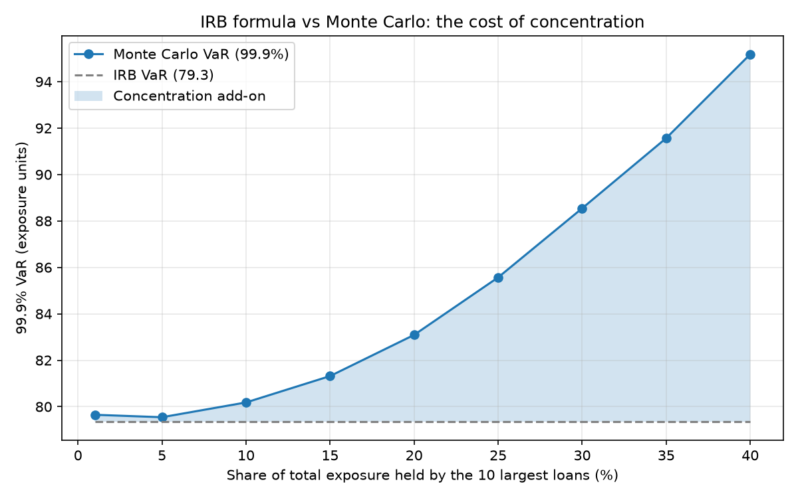
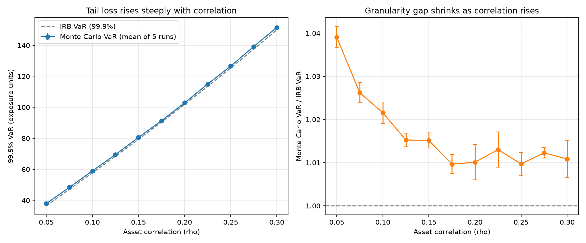
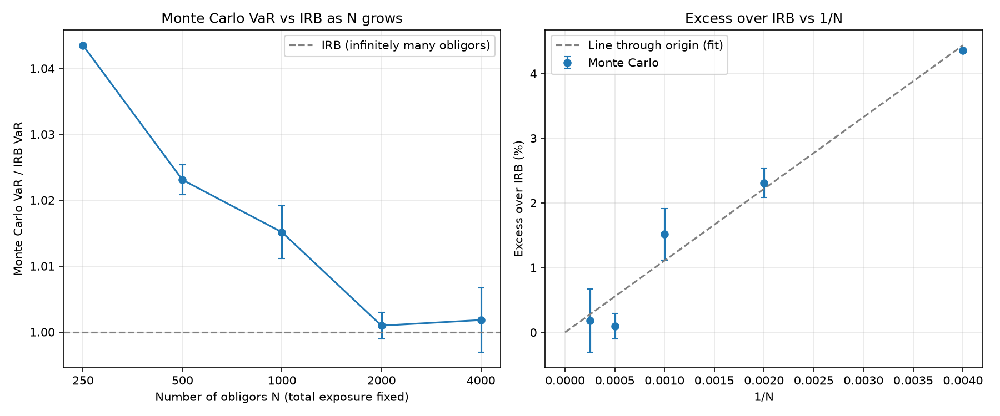

# Credit Loss Monte Carlo Engine (C++ / Python)

A multithreaded C++20 Monte Carlo engine for portfolio credit losses under the
Vasicek one-factor model (the model behind the Basel IRB capital formula),
exposed to Python via pybind11.

**Highlights**

- About 9x faster than a vectorised NumPy implementation on a multi-core Mac, with
  identical results for any thread count
- Converges to the closed-form Basel IRB value as portfolios become granular
- Quantifies what the IRB formula ignores: with 40% of exposure in 10 loans, the
  99.9% VaR is about 20% above the IRB figure
- 14 unit tests (Catch2), built and tested on Linux and macOS in CI

## Model

Each obligor `i` defaults if its asset value falls below its default threshold:

```
sqrt(rho) * Z + sqrt(1 - rho) * eps_i  <  Phi^-1(PD_i)
```

`Z` is a common (systematic) factor shared by all obligors, `eps_i` is the obligor's own
shock, and `rho` is the asset correlation. The portfolio loss in a scenario is the sum of
`EAD_i * LGD_i` over the obligors that default. The Basel IRB formula is the limit of this
model for infinitely many small obligors, which gives a closed form to validate against.

## Features

- Heterogeneous portfolios: different PD, EAD and LGD per obligor
- Reproducible: results depend only on the seed, not on the number of threads
  (each block of 1,024 scenarios has its own independently seeded generator)
- Fast random numbers: xoshiro256++ with a hand-written normal sampler
- Validated against a pure NumPy reference and the closed-form IRB formula

## Build

Requires a C++20 compiler, CMake 3.18+ and Python 3.9+.

```bash
python3 -m venv .venv
source .venv/bin/activate
pip install -r requirements.txt
cmake -S . -B build -Dpybind11_DIR=$(python -m pybind11 --cmakedir)
cmake --build build -j
```

Run the unit tests:

```bash
ctest --test-dir build --output-on-failure
```

Run the experiments (each script prints results and the plots are saved to `docs/`):

```bash
cd python
python compare.py
python concentration.py
python plot_concentration.py
python plot_correlation.py
python plot_convergence.py
```

## Results

### Validation and speed

1,000 obligors, 200,000 scenarios, Apple Silicon Mac: the C++ engine matches the NumPy
reference and the analytical expected loss, and runs roughly 9-10x faster.

### Concentration effect

1,000 obligors, 1M scenarios, PD 2%, LGD 45%, rho 0.15, total exposure fixed. The IRB
formula gives one VaR for every row because it ignores concentration:

| Top-10 share of exposure | MC VaR (99.9%) | MC / IRB | ES (99.9%) |
|---|---|---|---|
| 1% (equal loans) | 79.65 | 1.004 | 93.96 |
| 10% | 80.18 | 1.011 | 95.10 |
| 20% | 83.09 | 1.047 | 98.49 |
| 30% | 88.55 | 1.116 | 104.23 |
| 40% | 95.18 | 1.200 | 112.00 |

IRB VaR is 79.35 in every row. With 40% of exposure in 10 loans, simulated tail risk is
about 20% above the IRB figure.



### Correlation sweep

1,000 equal obligors, PD 2%, LGD 45%, 1M scenarios x 5 runs per point. Monte Carlo VaR
tracks the IRB formula closely; the excess over IRB is about 4% at rho = 0.05 and falls
to about 1% for rho >= 0.175 (error bars are standard errors over 5 runs).



### Convergence to IRB

Equal obligors, total exposure fixed, rho 0.15, 1M scenarios x 5 runs. As the number of
obligors grows, Monte Carlo VaR converges to the Basel IRB value, which assumes infinitely
many obligors: the ratio falls from 1.04 at N = 250 to about 1.00 at N >= 2,000, and the
excess is consistent with scaling as 1/N. (At small N the loss distribution is discrete, so
the N = 250 error bar understates the true uncertainty.)



## Tests

14 unit tests (Catch2) cover the normal distribution functions, the IRB formula against
independently computed values, input validation, reproducibility across thread counts, and
statistical checks of the simulation (mean loss against expected loss, and the tail VaR of a
large portfolio against the IRB value). CI runs them on Linux and macOS for every push, and
also checks that the Python module builds and imports.

## Limitations

- One systematic factor, a single correlation shared by all obligors, and a one-period horizon
- Constant LGD per obligor (no stochastic recovery) and no rating migration
- VaR at the 99.9% level rests on a small number of tail scenarios, so results are noisy
  unless the scenario count is large; the experiments average several seeds and report
  standard errors

## Layout

- `include/creditmc/engine.hpp`, `src/engine.cpp`: simulation engine
- `src/bindings.cpp`: pybind11 module `creditmc_core`
- `tests/test_engine.cpp`: Catch2 unit tests
- `python/reference.py`: NumPy reference implementation
- `python/compare.py`: validation and benchmark
- `python/concentration.py`: concentration experiment (table)
- `python/plot_concentration.py`: concentration plot
- `python/plot_correlation.py`: correlation sweep plot
- `python/plot_convergence.py`: convergence plot
- `.github/workflows/ci.yml`: continuous integration
